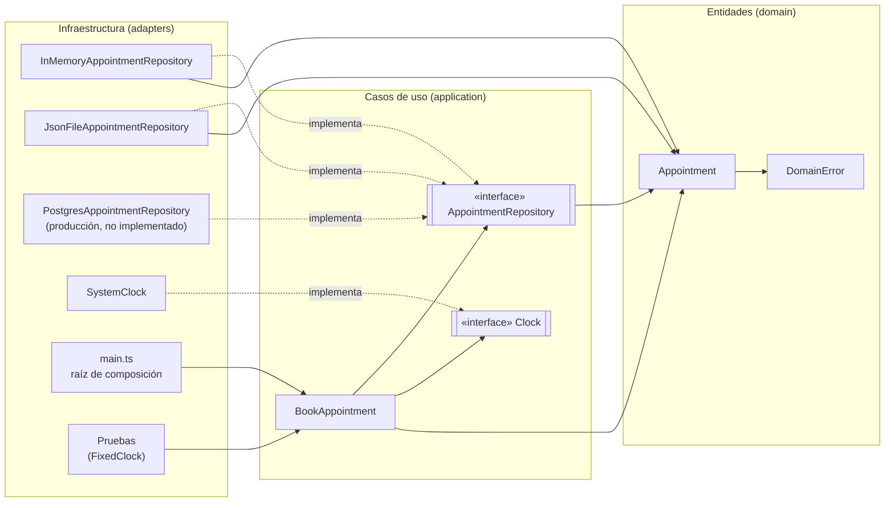

# BarberOS — Sistema de gestión para barbería con tienda

**Actividad #3: Clean Architecture aplicada a tu proyecto**
Materia: Frameworks y Arquitectura de · Profesor: Zabaleta Duran Adrián Rene
Equipo: Pozas Gomez Fernando, expediente 333414. Juan Pablo Bolaños Rivera, expediente 326570. Julio Alberto Tecuapacho Velázquez, expediente 333364.

```bash
npm test          # 13 pruebas: el mismo caso de uso con el adapter en memoria y con el de archivo JSON
npm run demo      # corre el caso de uso con el adapter en memoria
npm run demo json # el mismo caso de uso guardando en data/citas.json
```

Requiere Node.js 22.18 o más nuevo (corre TypeScript directo, sin compilar). No tiene dependencias: no hace falta `npm install`.

---

## Parte 1. Identificar el núcleo

Tomamos tres reglas del PF #5 (numeración del Proyecto #6):

**BR-03. Un barbero no puede tener dos citas a la misma hora.**
Es una regla del negocio porque sale de cómo trabaja una barbería: un barbero atiende a una persona a la vez y su tiempo es lo que se vende. Se cumpliría igual si la agenda fuera una libreta de papel; no depende de la base de datos, de la web ni de la pasarela de pago.

**BR-06. La cita se puede cambiar o cancelar hasta 2 horas antes.**
Es una política del dueño para no perder horas que ya nadie puede tomar. El número 2 lo decide el negocio; si mañana fueran 3 horas, cambia la regla, no la tecnología. Que el aviso llegue por correo o por una app es infraestructura; el límite de tiempo no.

**BR-10. No se vende un producto que no hay; mostrador y tienda en línea usan el mismo inventario.**
Vender algo que no existe le cuesta al negocio un cliente molesto y una devolución. Que haya una sola existencia para los dos canales es una decisión de cómo opera el local, no de dónde se guarda el número.

Entidades involucradas y sus atributos principales:

| Entidad | Atributos principales | Reglas |
|---|---|---|
| Appointment | id, barberId, customerId, start, durationMin, status (apartada, confirmada, cancelada), holdExpiresAt | BR-03, BR-06 |
| Barber | id, name, schedule, commissionRate | BR-03 |
| Customer | id, name, email | BR-03, BR-06 |
| Product | id, name, price, stock | BR-10 |
| Sale | id (generado en el celular), barberId, items, total, method, createdAt | BR-10 |
| Order | id, customerId, items, total, status | BR-10 |

## Parte 2. Diseño por capas

### BR-03. Un barbero no puede tener dos citas a la misma hora (implementada en código)

- **Entity `Appointment`.** Validaciones al crearla: id, barbero y cliente obligatorios; duración entera de 15 a 180 minutos; no se agenda en el pasado; dentro del horario del local, lunes a sábado de 10:00 a 20:00 (BR-05). Nace `apartada` con `holdExpiresAt` = ahora + 10 min (BR-02). Expone `conflictsWith(otra, ahora)`: hay choque si es el mismo barbero, la otra cita sigue activa (no cancelada y con el apartado sin vencer) y los intervalos se enciman. Terminar justo cuando empieza la otra no es choque.
- **Use Case `BookAppointment`.**
  - Entrada: `appointmentId, barberId, customerId, start, durationMin`.
  - Salida: `appointmentId, status: "apartada", holdExpiresAt`.
  - Pasos: (1) crear la entidad, que valida; (2) pedir al repositorio las citas del barbero ese día; (3) si alguna activa choca, lanzar `DomainError`; (4) guardar el apartado; (5) regresar la salida.
- **Repository `AppointmentRepository`:** `findByBarberAndDay(barberId, day)` y `save(appointment)`. También usa el puerto `Clock.now()` para no depender del reloj del sistema.
- **Adapters:** `InMemoryAppointmentRepository` (un `Map`, para pruebas) y `JsonFileAppointmentRepository` (archivo JSON). En producción sería PostgreSQL con una restricción de exclusión sobre `(barber_id, rango de horas)`, que es lo que garantiza la regla cuando dos personas reservan en el mismo segundo (ADR-002).

### BR-06. Cancelar hasta 2 horas antes

- **Entity `Appointment`.** `cancel(ahora)`: si faltan menos de 2 horas para `start`, lanza `DomainError`; si ya estaba cancelada, también. Si no, pasa a `cancelada` y deja de ocupar el horario (`isActive` = false).
- **Use Case `CancelAppointment`.**
  - Entrada: `appointmentId, customerId`.
  - Salida: `appointmentId, status: "cancelada"`.
  - Pasos: (1) buscar la cita por id; si no existe, error; (2) comprobar que la cita es de ese cliente; (3) `appointment.cancel(clock.now())`; (4) guardar; (5) pedir al `Notifier` que avise al cliente y al barbero.
- **Repository `AppointmentRepository`:** `findById(id)` y `save(appointment)`. Puertos extra: `Clock` y `Notifier.appointmentCancelled(appointment)`.
- **Adapters:** PostgreSQL para el repositorio; para `Notifier`, un adapter que manda correo transaccional por la API del proveedor (los avisos van por correo, ADR-005).

### BR-10. No vender lo que no hay, con un solo inventario

- **Entity `Product`.** Validaciones: precio mayor a 0, existencia entera y nunca negativa. `decrease(cantidad)`: la cantidad debe ser entera y mayor a 0, y si es mayor que `stock` lanza `DomainError`.
- **Use Case `RecordSale`** (el mismo lo usan el mostrador y la tienda en línea).
  - Entrada: `saleId, barberId, items [{productId, qty}], method`.
  - Salida: `saleId, total`.
  - Pasos: (1) buscar cada producto; (2) calcular el total con el precio guardado, nunca con el que manda el cliente; (3) descontar la existencia de cada producto; si uno no alcanza, no se registra nada; (4) guardar la venta.
- **Repository `ProductRepository`:** `findById(id)` y `decreaseStock(productId, qty): boolean`, atómico: descuenta solo si alcanza. `SaleRepository.saveIfAbsent(sale)`, idempotente por el id que genera el celular (BR-09).
- **Adapters:** PostgreSQL (`UPDATE ... SET stock = stock - $1 WHERE id = $2 AND stock >= $1` dentro de una transacción); en el celular, IndexedDB para la cola de ventas sin internet.

### Diagrama de capas

Todas las flechas apuntan hacia el centro. Los adapters dependen de los puertos (las interfaces), nunca al revés.



Verificación: en `src/domain/` y `src/application/` no hay un solo `import` de `infrastructure/`, de `node:fs` ni de ninguna librería externa.

```
src/
  domain/          Appointment, DomainError                       (no importa nada de afuera)
  application/     BookAppointment, AppointmentRepository, Clock  (solo importa domain)
  infrastructure/  adapters en memoria y JSON, SystemClock        (importa application y domain)
  main.ts          elige el adapter
test/
  book-appointment.suite.ts           las pruebas del caso de uso, para cualquier adapter
  book-appointment.in-memory.test.ts  Parte 3
  book-appointment.json-file.test.ts  Parte 4
```

## Parte 3. Implementación

Regla implementada completa: **BR-03**, con el caso de uso `BookAppointment`.

Las pruebas del caso de uso están en `test/book-appointment.suite.ts` y se corren con `InMemoryAppointmentRepository`, sin base de datos y con un reloj fijo:

1. Aparta un horario libre por 10 minutos y lo guarda.
2. Rechaza una cita que se encima con otra del mismo barbero (BR-03) y no guarda la segunda.
3. Permite la cita que empieza justo cuando termina la anterior.
4. Permite la misma hora con otro barbero.
5. Libera el horario cuando el apartado venció sin pago (BR-02).
6. Rechaza una cita fuera del horario del local sin guardar nada (BR-05).

## Parte 4. Swap de infraestructura

Cambiamos el adapter en memoria por `JsonFileAppointmentRepository`, que guarda las citas en un archivo JSON. La suite de pruebas es la misma función: `test/book-appointment.json-file.test.ts` solo le pasa otro adapter. Se agregó una prueba propia del adapter: una cita guardada sigue bloqueando el horario aunque se abra otra instancia del adapter sobre el mismo archivo (como si se reiniciara el programa).

**`Appointment` y `BookAppointment` no cambiaron ni una línea.** Antes de escribir el adapter JSON sacamos el SHA-256 de cada archivo de `src/domain/` y `src/application/`, y después del cambio volvió a dar igual en los cinco. También se puede comprobar con el historial: `git diff 4463aea -- src/domain src/application` (el commit de la Parte 3 contra hoy) no muestra nada. Lo único que se tocó fuera de los adapters es `main.ts`, que es donde se decide qué adapter usar.

Lo que pudo habernos acoplado: para leer una cita del archivo hay que reconstruir la entidad. Si `Appointment` solo tuviera `create()`, el adapter JSON no podría reconstruir una cita de ayer, porque `create()` rechaza fechas en el pasado, y habríamos tenido que meterle a la entidad un "modo carga" pensado para el archivo. Lo evitamos desde la Parte 3 separando `create()` (cita nueva, con todas las validaciones) de `restore()` (cita que ya existía), y con `toSnapshot()`, que da un objeto plano sin saber si va a un `Map`, a un archivo o a una tabla.

Lo que el adapter JSON no resuelve: dos procesos que reservan al mismo tiempo pueden leer el archivo, no ver choque y guardar los dos. Eso no se arregla en el caso de uso sino en el adapter de producción, con la restricción de exclusión de PostgreSQL (ADR-002); el puerto y el caso de uso se quedarían igual.

## Parte 5. Cierre

**¿Qué parte de su proyecto les costó más ubicar en una capa?**
El apartado de 10 minutos (BR-02). Al principio lo veíamos como algo técnico, un temporizador o un cron que borra apartados viejos, y eso es infraestructura. Pero que un horario no pagado deje de contar después de 10 minutos es una regla del negocio. La solución fue poner en la entidad la fecha de vencimiento y el método `isActive(ahora)`, y dejar afuera solo la limpieza física de los registros vencidos. La hora actual también costó: si el caso de uso llama a `new Date()` ya depende del reloj del sistema y no se puede probar, así que se volvió el puerto `Clock`.

**¿Qué ganan con poder cambiar la infraestructura sin tocar el núcleo?**
Que las reglas se prueban en milisegundos sin levantar una base de datos, y que esas mismas pruebas sirven para validar cualquier adapter nuevo: si el de PostgreSQL pasa la suite, cumple la regla. También podemos posponer decisiones caras, como qué base de datos usar o si el celular guarda en IndexedDB, sin detener el desarrollo, y si mañana cambia el proveedor de correo o de base de datos, el riesgo queda encerrado en un solo archivo.
